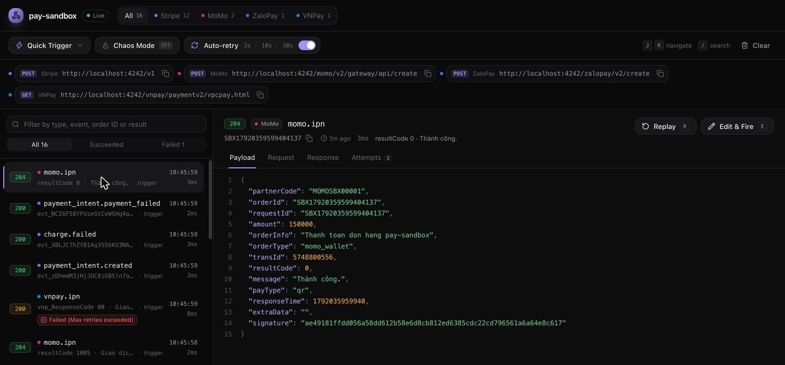
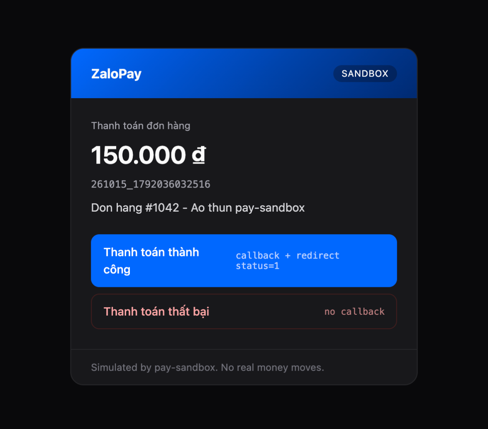
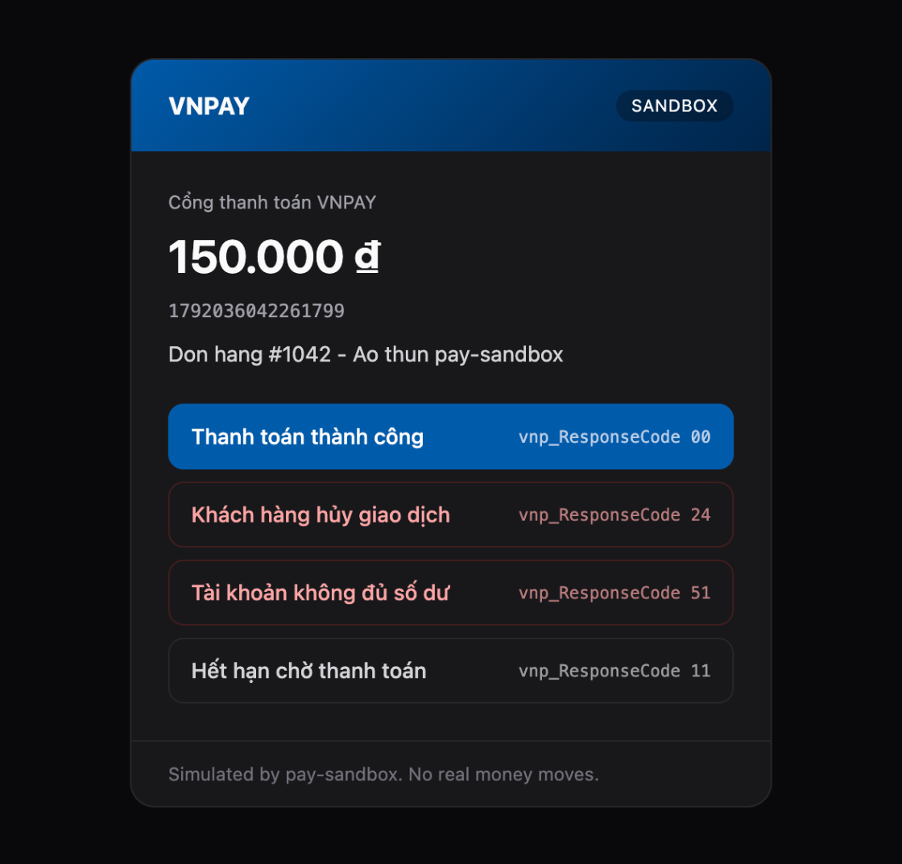
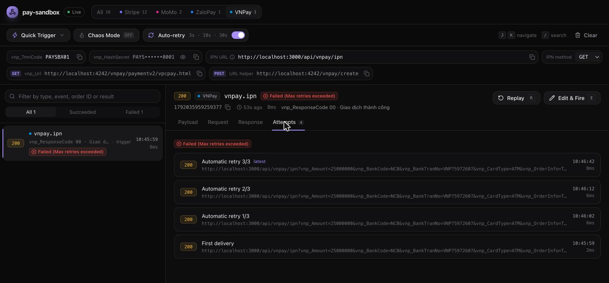

# pay-sandbox

[](LICENSE)
[](https://github.com/nhan7tuoi/pay-sandbox)

**A local, stateful payment gateway sandbox for Stripe, MoMo, ZaloPay and VNPay.**
Real signed webhooks, retries, chaos testing and a live dashboard. One command, no accounts, no tunnels, no internet.



```bash
npx pay-sandbox
```

> **Status:** pre-release. The package is not on npm yet; until the first release, [run it from source](#run-from-source).

---

## Why

Testing payments usually means one of three bad options:

| | stripe-mock | Gateway test environments | **pay-sandbox** |
|---|---|---|---|
| Remembers what you created | ❌ stateless | ✅ | ✅ in memory |
| Sends real webhooks to `localhost` | ❌ | needs ngrok / a public URL | ✅ directly |
| Signatures your code can verify | ❌ | ✅ | ✅ byte-for-byte |
| Force declines, expiries, timeouts | limited | hard | ✅ one click |
| Retries, dropped webhooks, latency | ❌ | not on demand | ✅ Chaos Mode |
| Works offline, in CI, on a plane | ✅ | ❌ | ✅ |
| MoMo / ZaloPay / VNPay | ❌ | separate portal each | ✅ same tool |

pay-sandbox implements each gateway's **real request and signature format**, so the integration code you test locally is the code you ship. Only the base URL and keys change.

## Features

- **Four gateways, one tool.** Stripe (`/v1` API), MoMo (AIO v2), ZaloPay (v2) and VNPay (2.1.0), each behind a provider adapter.
- **Real signatures.** `Stripe-Signature` (HMAC-SHA256), MoMo `signature` (HMAC-SHA256), ZaloPay `mac` (key1/key2) and VNPay `vnp_SecureHash` (HMAC-SHA512). Requests with a wrong signature are rejected the way the real gateway rejects them.
- **Hosted payment pages.** `payUrl`, `order_url`, Checkout `url` and the VNPay redirect URL all open a page where you pick the outcome: success, expired, declined by user, insufficient funds and more.
- **Webhook dispatcher with retries.** Failed deliveries are retried on a backoff schedule (3s, 10s, 30s by default). Each gateway's acknowledgement rule is respected: Stripe `2xx`, MoMo `204`, ZaloPay `return_code: 1`, VNPay `RspCode 00/02`.
- **Chaos Mode.** Slow or failing API responses, webhook latency spikes, and dropped webhooks.
- **Stripe extras.** `Idempotency-Key` replay (24 h), refunds, Checkout Sessions, disputes, and Stripe's test payment methods (`pm_card_visa`, `pm_card_chargeDeclined`, …).
- **Dashboard.** Live webhook log, provider tabs, replay, edit & fire (with a deliberately wrong signature if you want), quick triggers and per-gateway credentials.
- **Built for CI.** A control API (`/__sandbox/*`), and `buildServer()` for running the sandbox inside your test process.

## Documentation

| Guide | Covers |
|---|---|
| [Stripe](docs/stripe.md) | SDK setup, webhooks, test cards, forced outcomes, Checkout, refunds, idempotency, supported API |
| [MoMo](docs/momo.md) | create, payment page, IPN (`204`), redirect, query, result codes |
| [ZaloPay](docs/zalopay.md) | create (`key1`), callback (`key2`), redirect checksum, query, status codes |
| [VNPay](docs/vnpay.md) | signed payment URL, IPN and `RspCode`, return URL, response codes |
| [Dashboard](docs/dashboard.md) | inspecting, replay, edit & fire, quick triggers, retries, chaos |
| [Control API](docs/sandbox-api.md) | `/__sandbox/*` for automated tests, `buildServer()` |

## Quick start

### 1. Start the sandbox

```bash
npx pay-sandbox
```

```text
  pay-sandbox v0.1.0  ready

  Dashboard    http://localhost:4242/dashboard

  Stripe       http://localhost:4242/v1  webhooks → http://localhost:3000/api/webhook
  MoMo         http://localhost:4242/momo/v2/gateway/api/create  partnerCode MOMOSBX00001
  ZaloPay      http://localhost:4242/zalopay/v2/create  app_id 2554
  VNPay        http://localhost:4242/vnpay/paymentv2/vpcpay.html  IPN → http://localhost:3000/api/vnpay/ipn
```

### 2. Point your app at it

Change the base URL and keys. Everything else in your integration stays the same.

| Gateway | Real endpoint | pay-sandbox endpoint | Webhooks go to |
|---|---|---|---|
| Stripe | `https://api.stripe.com` | `http://localhost:4242` | `--webhook-url` (default `http://localhost:3000/api/webhook`) |
| MoMo | `https://test-payment.momo.vn` | `http://localhost:4242/momo` | the `ipnUrl` in each create request |
| ZaloPay | `https://sb-openapi.zalopay.vn` | `http://localhost:4242/zalopay` | the `callback_url` in each create request |
| VNPay | `https://sandbox.vnpayment.vn` | `http://localhost:4242/vnpay` | IPN URL set on the dashboard (default `http://localhost:3000/api/vnpay/ipn`) |

Default credentials (all editable on the dashboard):

| Gateway | Credentials |
|---|---|
| Stripe | any secret key, e.g. `sk_test_sandbox` · webhook secret `whsec_test_sandbox_secret` |
| MoMo | partnerCode `MOMOSBX00001` · accessKey `paysandboxmomoaccess` · secretKey `paysandboxmomosecretkey000000001` |
| ZaloPay | app_id `2554` · key1 `paysandboxzalopaykey1000000000001` · key2 `paysandboxzalopaykey2000000000002` |
| VNPay | vnp_TmnCode `PAYSBX01` · vnp_HashSecret `PAYSANDBOXVNPAYHASHSECRET0000001` |

These are sandbox-only values. They are not, and do not work as, real gateway credentials.

### 3. Pay

Create an order from your app, open the returned payment URL, pick an outcome, and watch the signed webhook arrive in your backend and on the dashboard.

## Demo

### Stripe in 30 seconds

```js
import Stripe from "stripe";

const stripe = new Stripe("sk_test_sandbox", { host: "localhost", port: 4242, protocol: "http" });

const intent = await stripe.paymentIntents.create({
  amount: 2000,
  currency: "usd",
  payment_method: "pm_card_visa",
  confirm: true,
});
console.log(intent.status); // "succeeded", and payment_intent.succeeded is on its way to your webhook
```

Swap in `pm_card_chargeDeclined` and the SDK throws a real `StripeCardError` with `code: "card_declined"`, followed by a `payment_intent.payment_failed` webhook.

### MoMo, ZaloPay and VNPay

Each gateway opens its own simulated payment page, so you can test the outcomes that are hard to trigger in a real test environment:

| MoMo | ZaloPay | VNPay |
|---|---|---|
|  |  |  |

The full create → pay → IPN flow, with copy-paste Node.js code for each gateway, is in the guides:

- [**Stripe guide**](docs/stripe.md): SDK setup, webhooks, test cards, refunds, idempotency, Checkout
- [**MoMo guide**](docs/momo.md): create, IPN, query, result codes 0 / 1005 / 1006 / …
- [**ZaloPay guide**](docs/zalopay.md): create, callback, redirect checksum, query
- [**VNPay guide**](docs/vnpay.md): payment URL, IPN, `RspCode` handling, response codes

### No app yet? Use the dashboard

Open `http://localhost:4242/dashboard`, pick **Quick Trigger** and fire, for example, *MoMo: Hết hạn giao dịch (code 1005)* or *VNPay: Bắn IPN thành công (00)*. The sandbox creates the order, settles it and sends the signed notification to your webhook URL.

## Dashboard, retries and chaos



Every webhook shows its payload, the exact request (method, URL, query, headers, body), your endpoint's response, and each delivery attempt. When a delivery fails, the sandbox retries it and shows the countdown. The screenshot above is a VNPay IPN that the merchant answered with `RspCode 01`, so it was retried three times before *Max retries exceeded*.

See the [dashboard guide](docs/dashboard.md) for Replay, Edit & Fire, Chaos Mode and auto-retry settings.

## CLI

```text
npx pay-sandbox [options]

  -p, --port <number>          Port for the API and dashboard   (default 4242)
      --host <address>         Interface to bind                (default 127.0.0.1)
  -w, --webhook-url <url>      Where Stripe webhooks are sent   (default http://localhost:3000/api/webhook)
  -s, --webhook-secret <sec>   Stripe signing secret            (default whsec_test_sandbox_secret)
      --api-version <ver>      api_version stamped on events    (default 2025-09-30.clover)
      --webhook-timeout <ms>   Per-attempt delivery timeout     (default 5000)
      --retry-schedule <s,..>  Retry delays in seconds          (default 3,10,30)
      --no-retry               Disable automatic webhook retries
  -q, --quiet                  Do not log API requests and webhook deliveries
  -v, --version                Print the version
  -h, --help                   Show this help
```

Environment variables: `PAY_SANDBOX_PORT`, `PAY_SANDBOX_HOST`, `PAY_SANDBOX_WEBHOOK_URL`, `PAY_SANDBOX_WEBHOOK_SECRET`, `PAY_SANDBOX_RETRY_SCHEDULE`.

## Using it in automated tests

Run the CLI next to your test suite and drive it through the [control API](docs/sandbox-api.md):

```bash
# Settle an existing MoMo order as "expired" and send the IPN
curl -X POST http://localhost:4242/__sandbox/providers/momo/orders/ORDER123/webhook \
  -H 'content-type: application/json' -d '{"status": "1005"}'

# Reset all state between tests
curl -X POST http://localhost:4242/__sandbox/reset
```

Or start it inside the test process:

```js
import { buildServer } from "pay-sandbox";

const sandbox = await buildServer({
  config: { port: 0, webhookUrl: "http://localhost:3000/api/webhook" },
});
const baseUrl = await sandbox.app.listen({ port: 0 }); // e.g. http://127.0.0.1:53121

// … run your tests against baseUrl …

await sandbox.app.close();
```

## How faithful is it?

pay-sandbox follows each gateway's published documentation for request fields, signature formats, result codes and acknowledgement rules. The repository's end-to-end tests verify every signature with code written independently from the gateway docs.

Still, it is a simulator, not the gateway. Known differences:

- State lives in memory and is lost on restart.
- **Stripe:** a focused subset of the API (customers, PaymentIntents, charges, refunds, Checkout Sessions, events). Prices, subscriptions and 3-D Secure flows are not simulated.
- **MoMo:** the error code for a bad create signature (`11`) and the HTTP status for errors (`400`) are best guesses; the docs do not specify them.
- **ZaloPay:** the redirect `status` for failed payments and the `sub_return_code` for pending or failed orders are not documented. The sandbox mirrors `return_code`.
- **VNPay:** `querydr` and refund APIs are not simulated yet.
- **Retries** use the sandbox's schedule (3s, 10s, 30s), not each gateway's production schedule (VNPay, for example, retries every 5 minutes, up to 10 times).

Always run a final round of tests against each gateway's own test environment before going live.

## Run from source

Requires Node.js 20 or newer.

```bash
git clone https://github.com/nhan7tuoi/pay-sandbox.git
cd pay-sandbox
npm install
npm run build
npm start                 # same as `npx pay-sandbox`
```

### Development

```bash
npm run dev               # API with hot reload on :4242 + dashboard (Vite) on :5173/dashboard/
npm run typecheck         # server + dashboard
npm run test:client       # Stripe end-to-end checks with the official stripe SDK
npm run test:gateways     # MoMo / ZaloPay / VNPay end-to-end checks
```

Both test scripts start a webhook receiver on port 3000, so start the sandbox first (`npm run dev:server`).

```text
src/
  cli.ts, server.ts         CLI entry point and Fastify server
  providers/                BaseProvider interface + stripe, momo, zalopay, vnpay adapters
  webhook/                  dispatcher (retries, chaos) and Stripe signer
  routes/                   Stripe /v1 router, idempotency, dashboard control API
  services/                 Stripe domain logic (PaymentIntents, refunds, Checkout, …)
ui/                         React + Vite + Tailwind dashboard
docs/                       per-gateway guides
```

## Contributing

Bug reports, gateway behaviour that doesn't match the real one, and pull requests are welcome on [GitHub](https://github.com/nhan7tuoi/pay-sandbox/issues). When reporting a fidelity issue, please link the gateway documentation that describes the expected behaviour.

## License

[MIT](LICENSE) © 2026 Pham Duc Nhan
