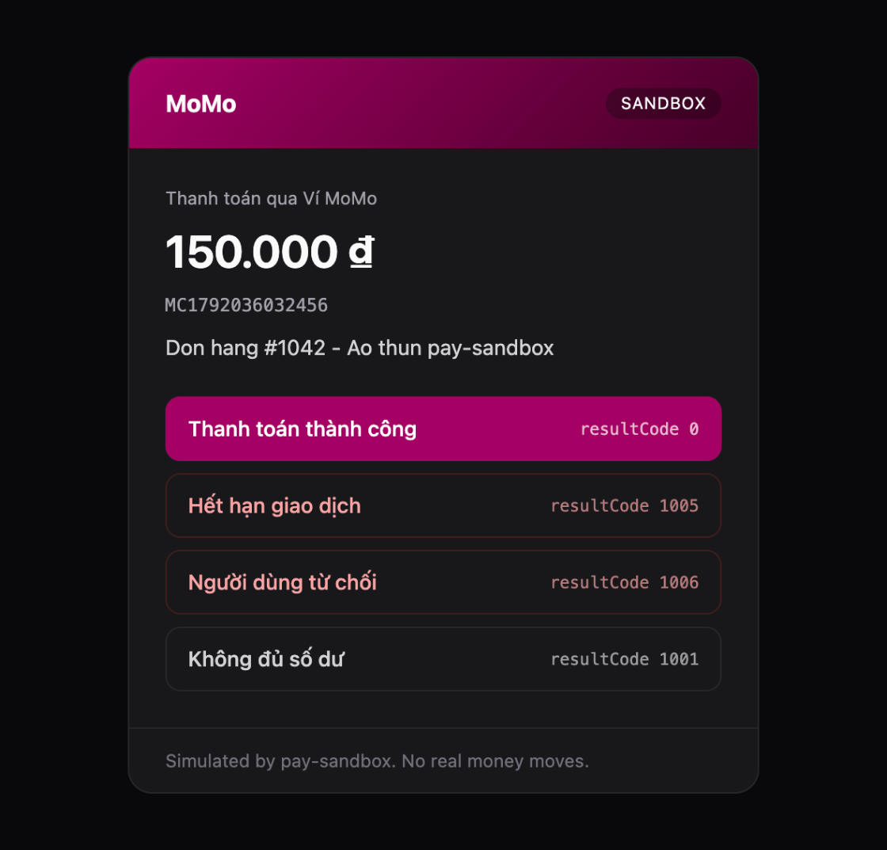

# MoMo

pay-sandbox simulates the MoMo Payment Gateway (AIO v2, `captureWallet` and the other one-time `requestType`s). It checks your create request's HMAC-SHA256 signature, gives you a `payUrl`, lets you choose the outcome on a simulated wallet page, and sends a signed IPN to your `ipnUrl`.



- [Endpoints and credentials](#endpoints-and-credentials)
- [1. Create a payment](#1-create-a-payment)
- [2. Customer pays](#2-customer-pays)
- [3. Handle the IPN](#3-handle-the-ipn)
- [4. Redirect back to your site](#4-redirect-back-to-your-site)
- [5. Query a transaction](#5-query-a-transaction)
- [Result codes](#result-codes)
- [Test scenarios](#test-scenarios)
- [Troubleshooting](#troubleshooting)
- [Differences from MoMo](#differences-from-momo)

## Endpoints and credentials

| | MoMo test environment | pay-sandbox |
|---|---|---|
| Base URL | `https://test-payment.momo.vn` | `http://localhost:4242/momo` |
| Create | `POST /v2/gateway/api/create` | `POST /momo/v2/gateway/api/create` |
| Query | `POST /v2/gateway/api/query` | `POST /momo/v2/gateway/api/query` |
| Payment page | MoMo app / web | `GET /momo/pay/:orderId` |

| Credential | Default |
|---|---|
| `partnerCode` | `MOMOSBX00001` |
| `accessKey` | `paysandboxmomoaccess` |
| `secretKey` | `paysandboxmomosecretkey000000001` |

Change them on the dashboard (**MoMo** tab). Your app should read the base URL and keys from configuration, so switching to MoMo's test or production environment is a config change.

## 1. Create a payment

The signature is `HMAC_SHA256(secretKey, rawSignature)` in lowercase hex. `rawSignature` lists these fields in alphabetical order, joined with `&`, with **no URL-encoding**:

```text
accessKey=$accessKey&amount=$amount&extraData=$extraData&ipnUrl=$ipnUrl&orderId=$orderId
&orderInfo=$orderInfo&partnerCode=$partnerCode&redirectUrl=$redirectUrl&requestId=$requestId
&requestType=$requestType
```

(Shown on two lines for readability; the real string has no line breaks.)

```js
import crypto from "node:crypto";

const MOMO = {
  endpoint: "http://localhost:4242/momo", // https://test-payment.momo.vn in MoMo's test environment
  partnerCode: "MOMOSBX00001",
  accessKey: "paysandboxmomoaccess",
  secretKey: "paysandboxmomosecretkey000000001",
};
const hmacSha256 = (key, data) => crypto.createHmac("sha256", key).update(data).digest("hex");

async function createMomoPayment({ orderId, amount, orderInfo }) {
  const requestId = orderId;
  const requestType = "captureWallet";
  const extraData = "";
  const redirectUrl = "http://localhost:3000/payment/momo/return";
  const ipnUrl = "http://localhost:3000/api/momo/ipn";

  const rawSignature =
    `accessKey=${MOMO.accessKey}&amount=${amount}&extraData=${extraData}&ipnUrl=${ipnUrl}` +
    `&orderId=${orderId}&orderInfo=${orderInfo}&partnerCode=${MOMO.partnerCode}` +
    `&redirectUrl=${redirectUrl}&requestId=${requestId}&requestType=${requestType}`;

  const response = await fetch(`${MOMO.endpoint}/v2/gateway/api/create`, {
    method: "POST",
    headers: { "content-type": "application/json" },
    body: JSON.stringify({
      partnerCode: MOMO.partnerCode,
      requestId,
      amount,
      orderId,
      orderInfo,
      redirectUrl,
      ipnUrl,
      requestType,
      extraData,
      lang: "vi",
      signature: hmacSha256(MOMO.secretKey, rawSignature),
    }),
  });
  return response.json(); // { resultCode: 0, payUrl, qrCodeUrl, deeplink, ... }
}
```

Response:

```json
{
  "partnerCode": "MOMOSBX00001",
  "orderId": "ORDER1760500000001",
  "requestId": "ORDER1760500000001",
  "amount": 150000,
  "responseTime": 1792036188134,
  "message": "Thành công.",
  "resultCode": 0,
  "payUrl": "http://localhost:4242/momo/pay/ORDER1760500000001",
  "deeplink": "momo://app?action=payWithApp&isScanQR=false&serviceType=app&sid=TU9NTw_puXzSH4A13HrbxMbN1MvRe8T&v=3.0",
  "qrCodeUrl": "http://localhost:4242/momo/pay/ORDER1760500000001?scan=qr",
  "deeplinkMiniApp": "http://localhost:4242/momo/pay/ORDER1760500000001?scan=miniapp",
  "signature": "9333ef2ca370fa0792de0575e63b93d0c3f3d5e6a3699de90559eb8c2aaa522b",
  "userFee": 0
}
```

`qrCodeUrl` points to the sandbox payment page, so a QR code you render from it opens the page in a browser instead of the MoMo app. The response `signature` covers `accessKey, amount, message, orderId, partnerCode, payUrl, requestId, responseTime, resultCode` in that order.

### Validation

The sandbox validates the request like MoMo does and answers **HTTP 400** with a `resultCode`:

| resultCode | When |
|---|---|
| `20` | a required field is missing, or `orderId` doesn't match `^[0-9a-zA-Z]([-_.]*[0-9a-zA-Z]+)*$` |
| `11` | unknown `partnerCode`, or the signature doesn't match |
| `22` | `amount` outside 1,000–50,000,000 VND |
| `40` | `requestId` already used |
| `41` | `orderId` already used |

`redirectUrl` and `extraData` are required but may be empty strings. When the signature is wrong, the message includes the exact raw string the sandbox signed, so you can diff it against yours:

```json
{
  "resultCode": 11,
  "message": "Truy cập bị từ chối. (Invalid signature. pay-sandbox signed this raw string with secretKey: accessKey=paysandboxmomoaccess&amount=150000&extraData=&ipnUrl=http://localhost:3000/api/momo/ipn&orderId=…)"
}
```

## 2. Customer pays

Redirect the customer to `payUrl`. The page offers four outcomes:

| Button | resultCode |
|---|---|
| Thanh toán thành công | `0` |
| Hết hạn giao dịch | `1005`: URL or QR code expired |
| Người dùng từ chối | `1006`: user declined to confirm |
| Không đủ số dư | `1001`: insufficient funds |

Choosing one sends the IPN and redirects the browser to your `redirectUrl`. Each order can be settled once.

## 3. Handle the IPN

MoMo POSTs JSON to your `ipnUrl`:

```json
{
  "partnerCode": "MOMOSBX00001",
  "orderId": "ORDER1760500000001",
  "requestId": "ORDER1760500000001",
  "amount": 150000,
  "orderInfo": "Thanh toan don hang #1042",
  "orderType": "momo_wallet",
  "transId": 3077535241,
  "resultCode": 0,
  "message": "Thành công.",
  "payType": "qr",
  "responseTime": 1792036188141,
  "extraData": "",
  "signature": "9375faa047094bd2dcf361cd8ee041c53ccc9f2eaa56c5ae7280b74536e116a6"
}
```

Verify the signature over these fields, alphabetically:

```text
accessKey, amount, extraData, message, orderId, orderInfo, orderType, partnerCode,
payType, requestId, responseTime, resultCode, transId
```

Then answer **HTTP 204 No Content**:

```js
import express from "express";

const app = express();

app.post("/api/momo/ipn", express.json(), (req, res) => {
  const b = req.body;
  const rawSignature =
    `accessKey=${MOMO.accessKey}&amount=${b.amount}&extraData=${b.extraData}&message=${b.message}` +
    `&orderId=${b.orderId}&orderInfo=${b.orderInfo}&orderType=${b.orderType}&partnerCode=${b.partnerCode}` +
    `&payType=${b.payType}&requestId=${b.requestId}&responseTime=${b.responseTime}` +
    `&resultCode=${b.resultCode}&transId=${b.transId}`;

  if (hmacSha256(MOMO.secretKey, rawSignature) !== b.signature) {
    return res.status(400).json({ message: "invalid signature" });
  }

  const order = orders.get(b.orderId);
  if (order && order.status === "pending") {
    order.status = b.resultCode === 0 ? "paid" : "failed"; // 1005 expired, 1006 declined by user, ...
  }
  res.status(204).end(); // MoMo expects 204 No Content
});
```

How the sandbox reads your answer:

| Your response | Result |
|---|---|
| `204` | acknowledged |
| other `2xx` | acknowledged, with the note *"MoMo expects HTTP 204 No Content"* on the dashboard |
| anything else, timeout (5 s), connection refused | failed, retried after 3s, 10s, 30s |

Update the order only while it is still pending. Retries and replays deliver the same IPN again.

## 4. Redirect back to your site

The browser lands on `redirectUrl` with the same fields as the IPN in the query string, including `signature`:

```text
http://localhost:3000/payment/momo/return?partnerCode=MOMOSBX00001&orderId=ORDER…&resultCode=0&message=Th%C3%A0nh+c%C3%B4ng.&…&signature=…
```

Verify it with the IPN formula and use it **only to show a result page**. The browser usually arrives before the IPN, so update the order from the IPN, never from the redirect.

## 5. Query a transaction

Use this to reconcile orders whose IPN never arrived.

```js
const requestId = `Q${Date.now()}`;
const rawSignature = `accessKey=${MOMO.accessKey}&orderId=${orderId}&partnerCode=${MOMO.partnerCode}&requestId=${requestId}`;

const response = await fetch(`${MOMO.endpoint}/v2/gateway/api/query`, {
  method: "POST",
  headers: { "content-type": "application/json" },
  body: JSON.stringify({ partnerCode: MOMO.partnerCode, requestId, orderId, lang: "vi", signature: hmacSha256(MOMO.secretKey, rawSignature) }),
});
```

```json
{
  "partnerCode": "MOMOSBX00001",
  "orderId": "ORDER1760500000001",
  "requestId": "Q1760500000002",
  "extraData": "",
  "amount": 150000,
  "transId": 3077535241,
  "payType": "qr",
  "resultCode": 0,
  "refundTrans": [],
  "message": "Thành công.",
  "responseTime": 1792036188156,
  "paymentOption": "momo",
  "promotionInfo": null
}
```

An unpaid order returns `resultCode: 1000` (waiting for the user). An unknown `orderId` returns `42`.

## Result codes

From [MoMo's result code table](https://developers.momo.vn/v3/docs/payment/api/result-handling/resultcode). The ones the sandbox produces:

| Code | Meaning | Final | How to get it |
|---|---|---|---|
| `0` | Successful | ✅ | payment page, trigger, control API |
| `1000` | Initiated, waiting for user confirmation | | query an unpaid order |
| `1001` | Insufficient funds | ✅ | payment page, control API |
| `1002` | Rejected by the payment method issuer | ✅ | control API |
| `1004` | Amount exceeds the payment limit | ✅ | control API |
| `1005` | URL or QR code expired | ✅ | payment page, trigger, control API |
| `1006` | User declined to confirm the payment | ✅ | payment page, trigger, control API |
| `1007` | Inactive or nonexistent account | ✅ | control API |
| `99` | Unknown error | ✅ | control API |
| `11`, `20`, `22`, `40`, `41`, `42` | request errors | | see [Validation](#validation) |

Note that **expired is `1005`**, not `1006`. `1006` means the user declined.

## Test scenarios

| Scenario | How |
|---|---|
| Successful payment | `payUrl` → *Thanh toán thành công* |
| Expired / declined / no funds | `payUrl` → the matching button |
| Any result code from a test | `POST /__sandbox/providers/momo/orders/:orderId/webhook` with `{"status": "1004"}` ([control API](sandbox-api.md)) |
| No app at all | dashboard → **Quick Trigger** → *MoMo: Thanh toán thành công (code 0)*, *Hết hạn giao dịch (code 1005)*, *Người dùng từ chối (code 1006)* |
| Your handler rejects forged IPNs | dashboard → select a MoMo IPN → **Edit & Fire** → *Wrong signature* → expect your 400 |
| Your handler is idempotent | dashboard → **Replay** a delivered IPN |
| IPN lost or late | **Chaos Mode** → *Simulate Dropped Webhook* / *Webhook Latency Spike* |

Quick Triggers create the order inside the sandbox, so your app has never seen that `orderId`. They are good for testing signature verification and response handling, not order lookup. To test the full flow, create the order from your app.

## Troubleshooting

**`resultCode 11`, invalid signature.** Compare your raw string with the one in the error message. Common causes:
- URL-encoding values (MoMo signs raw values);
- a field in the wrong order;
- `extraData` sent as `undefined` instead of `""`;
- `amount` serialized differently in the body and in the string (`150000` vs `"150000.0"`).

**The IPN never arrives.** `ipnUrl` must be reachable from the sandbox. Check the dashboard: a red `ERR` with *Connection refused* means nothing is listening on that URL.

**The dashboard shows the IPN in yellow.** Your endpoint answered `2xx` but not `204`. MoMo wants `204 No Content`.

## Differences from MoMo

- `qrCodeUrl` and `deeplinkMiniApp` point to the sandbox page; `deeplink` is a placeholder `momo://` link.
- Messages are written for the sandbox. Branch on `resultCode`, never on `message`.
- MoMo does not document the error code for a bad create signature or the HTTP status of errors; the sandbox uses `11` and `400`.
- Refunds, `autoCapture: false` (code `9000`), tokenization and recurring payments are not simulated.
- The retry schedule is the sandbox's (3s, 10s, 30s), not MoMo's.
